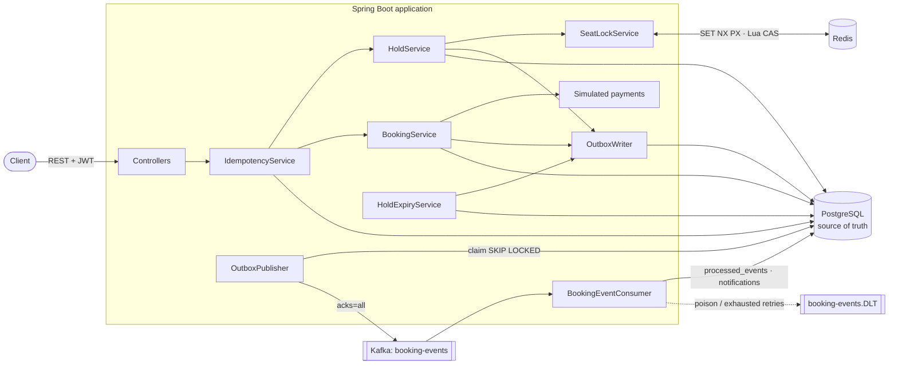
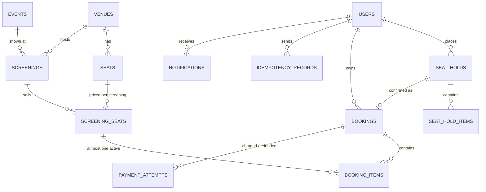

# Distributed Ticket Booking System

A Spring Boot backend for selling event tickets where **two customers can never buy the same seat for the
same screening**, even under a burst of simultaneous requests, Redis failures or Kafka outages.

Customers browse events, hold seats for 5 minutes, pay (simulated) and confirm, view and cancel bookings,
and receive notifications asynchronously. Admins manage venues, seat layouts, events, screenings and prices.

> **Status, stated plainly.** 70 automated tests (15 unit, 55 integration) pass against real PostgreSQL 16,
> Redis 7 and a real Kafka broker; the final code passed five consecutive full builds. The app was started
> from the packaged jar and exercised end to end, and a k6 load test was measured. **The Docker Compose file and
> Dockerfile were written but not executed in the build environment** (it had no Docker daemon), so treat them as
> untested until you run `docker compose up` yourself. This is a portfolio project, not a production-hardened system.

---

## Contents
1. [Features](#features) · 2. [Tech stack](#tech-stack) · 3. [Architecture](#architecture) ·
4. [Data model](#data-model) · 5. [Booking workflow](#booking-workflow) ·
6. [Concurrency strategy](#concurrency-and-seat-locking) · 7. [Consistency model](#redis-and-postgresql-consistency-model) ·
8. [Kafka & outbox](#kafka-and-the-transactional-outbox) · 9. [Idempotency](#idempotency) ·
10. [Security](#authentication-and-authorization) · 11. [API](#api) · 12. [Running it](#running-it) ·
13. [Testing](#testing) · 14. [Load test](#load-test) · 15. [Observability](#observability) ·
16. [Limitations & next steps](#known-limitations-and-future-improvements)

One-page summary (status, interview explanations, resume bullets): [`docs/PROJECT-SUMMARY.md`](docs/PROJECT-SUMMARY.md)

More detail: [`docs/ARCHITECTURE.md`](docs/ARCHITECTURE.md) (sequence + state diagrams, constraint table) ·
[`docs/DESIGN-DECISIONS.md`](docs/DESIGN-DECISIONS.md) · [`load-test/README.md`](load-test/README.md) ·
Postman: [`docs/postman/ticket-booking.postman_collection.json`](docs/postman/ticket-booking.postman_collection.json)

## Features
- Registration / login with BCrypt passwords and HS256 JWTs; `CUSTOMER` and `ADMIN` roles.
- Admin APIs: venues with seat layouts, events, screenings (overlaps in a venue rejected by a DB exclusion constraint), seat pricing per seat type.
- Public browsing: events (paginated), screening details, live seat map.
- **Seat holds** (all-or-nothing, multi-seat, 5 min TTL) protected by Redis locks *and* PostgreSQL.
- **Confirmation** with a simulated payment gateway; **cancellation** with refund until 2 h before the show.
- **Hold expiry worker**, safe with many instances.
- **Durable idempotency** (`Idempotency-Key`) for holds, confirmations and cancellations.
- **Transactional outbox → Kafka → idempotent notification consumer**, with retries and a dead-letter topic.
- Correlation IDs from HTTP request through Kafka to the consumer; Prometheus metrics; JSON logs in Docker.
- Development seed data (2 venues, 2 events, 3 screenings).

## Tech stack
| Area | Choice (version) |
|---|---|
| Language / build | Java 21, Maven 3.9 |
| Framework | Spring Boot **3.5.16** (Spring Framework 6.2, Spring Security 6.5) |
| Persistence | PostgreSQL 16, Spring Data JPA / Hibernate 6.6.53, Flyway 11.7.2, JDBC driver 42.7.11 |
| Locking | Redis 7 via Lettuce 6.6.0 (Spring Data Redis) |
| Messaging | Apache Kafka (client 3.9.2, Spring Kafka 3.3.16); broker image `apache/kafka:3.9.1` in Compose |
| Security | Spring Security + jjwt 0.12.6 |
| API docs | springdoc-openapi 2.8.17 (Swagger UI) |
| Observability | Actuator, Micrometer 1.15.12 + Prometheus registry, ECS structured logging |
| Tests | JUnit 5, Mockito, AssertJ, Spring Boot Test, Testcontainers 1.21.4, spring-kafka-test (embedded KRaft broker), Awaitility |
| Load test | k6 (tested with v0.57.0) |

All library versions except jjwt and springdoc are managed by the Spring Boot BOM.

## Architecture
A **modular monolith**: one deployable, packages per domain (`auth`, `event`, `venue`, `screening`, `seat`,
`booking`, `payment`, `idempotency`, `outbox`, `messaging`, `notification`, `security`, `config`, `common`,
`exception`). The notification side only talks to the rest through Kafka, so it could be split out later.



## Data model

Plus `outbox_events` and `processed_events` (no FKs: they are infrastructure tables). Full attribute-level
diagram and the constraint table are in [`docs/ARCHITECTURE.md`](docs/ARCHITECTURE.md); the schema itself is
[`V1__initial_schema.sql`](src/main/resources/db/migration/V1__initial_schema.sql).

Key rules:
- **Physical seats belong to venues; availability belongs to `screening_seats`** — one row per
  (screening, seat), enforced by `UNIQUE (screening_id, seat_id)`.
- A `CHECK` constraint makes illegal seat states unrepresentable (HELD ⇔ hold id + deadline; BOOKED ⇔ booking id).
- **Final invariant:** `CREATE UNIQUE INDEX ... ON booking_items (screening_seat_id) WHERE active` —
  PostgreSQL refuses a second active booking of a seat even if application code were bypassed (tested).
- `bookings.hold_id` is unique: one hold becomes at most one booking.
- All timestamps are `TIMESTAMPTZ`, written in UTC; the JVM is pinned to UTC.
- Hibernate runs with `ddl-auto=validate`; Flyway owns the schema.

**State machines** — Seat: `AVAILABLE → HELD → BOOKED → AVAILABLE(cancel)`, `HELD → AVAILABLE(release/expiry)`.
Hold: `ACTIVE → CONFIRMED | RELEASED | EXPIRED` (terminal). Booking: `CONFIRMED → CANCELLED` (terminal).
A hold *is* the pending phase of a purchase; a booking row exists only once paid.

## Booking workflow
1. `GET /screenings/{id}/seats` — pick `screeningSeatId`s.
2. `POST /screenings/{id}/holds` with `Idempotency-Key` → `201 {holdId, expiresAt}` or `409 SEAT_UNAVAILABLE`.
3. `POST /bookings/confirm {holdId, paymentMethodToken}` with `Idempotency-Key` → `201` booking,
   `410 HOLD_EXPIRED`, `402 PAYMENT_DECLINED` (hold kept, retry allowed), or `409 HOLD_NOT_ACTIVE`.
4. Within ~0.5 s the outbox publisher sends `BookingConfirmed`; the consumer creates an in-app notification
   and a (mock) email: `GET /notifications`.
5. Optional: `POST /bookings/{id}/cancel` (until 2 h before start) → seats return to AVAILABLE, refund recorded,
   `BookingCancelled` published. Unconfirmed holds expire after 5 min → `BookingExpired`.

The confirmation is **one PostgreSQL transaction**: lock hold → validate (owner, ACTIVE, not expired) →
charge → insert booking + items → conditional `HELD→BOOKED` update (row count must match) → hold `CONFIRMED`
→ outbox insert → idempotency record `COMPLETED` → commit. Any failure rolls back all of it
(tested by injecting a real PostgreSQL error at the last statement).

## Concurrency and seat locking
**Layer 1 – Redis (fast filter).** For each seat, in ascending id order:
`SET seat-lock:{screeningId}:{seatId} <holdId> NX PX 300000`. On any conflict the locks this request already
took are released with a Lua **compare-and-delete** (`if GET == token then DEL`), so a request can only delete
its own locks. After a booking commits, the hold's locks are converted (compare-and-set) into **sold markers**
`booked:<bookingId>` that live until the screening ends, so later attempts on sold seats are rejected without
touching PostgreSQL. The `{screeningId}` hash tag keeps a screening's keys in one Redis Cluster slot.

**Layer 2 – PostgreSQL (authority).** In the hold transaction:
`SELECT ... FROM screening_seats WHERE id IN (...) ORDER BY id FOR UPDATE` (deterministic order ⇒ no deadlocks),
then a single conditional update
`UPDATE screening_seats SET status='HELD', hold_id=?, held_until=? WHERE id IN (...) AND (status='AVAILABLE' OR (status='HELD' AND held_until <= now))`.
If the row count ≠ number of seats, the transaction rolls back: **multi-seat holds are all-or-nothing**.
Confirmation uses `... SET status='BOOKED' WHERE hold_id=? AND status='HELD' AND held_until > now`.

**Expiry worker.** Each expired hold is processed in its own short transaction:
`SELECT ... FOR UPDATE SKIP LOCKED` (multi-instance safe, never blocks a confirm in progress), conditional
`ACTIVE→EXPIRED`, then `releaseHeldSeats WHERE hold_id = :thisHold` — so a late worker can never free a seat
that a newer hold took over (tested). Redis cleanup happens after commit, by token. A missing Redis key is
never treated as proof of expiry; only the database deadline counts.

**Stale sold markers.** If a cancellation's Redis cleanup fails, its sold marker would block a seat PostgreSQL
considers free. On a conflict with a `booked:` marker, the hold path reads the seat's current booking id from
PostgreSQL; if it differs, the marker is removed (compare-and-delete) and the lock retried once. Live hold locks
are never "healed" (an earlier version did, and the load test exposed it — see `load-test/README.md`).

## Redis and PostgreSQL consistency model
| Situation | Behaviour | Why it is safe |
|---|---|---|
| Normal | Redis rejects most conflicts; PostgreSQL decides | DB constraints + conditional updates |
| Redis lock expired early / key lost (failover) | Request reaches PostgreSQL, which rejects it | Row lock + `WHERE status=...` |
| Redis completely down, `REDIS_FAILURE_MODE=DB_ONLY` (default) | Holds keep working on PostgreSQL alone; metric `booking_redis_degraded_total` | Correctness never depended on Redis (concurrency test passes with Redis down) |
| Redis down, `FAIL_CLOSED` | `503 LOCK_SERVICE_UNAVAILABLE`, nothing written | Explicit operator choice |
| Clock skew between app and Redis | At worst an unnecessary `409` until the lock TTL passes | Redis can only ever *reject*, never *grant* |
| Two requests race for one seat | Exactly one hold commits | `FOR UPDATE` + row-count check |
| Two confirms of one hold | Exactly one booking | Hold row lock + `UNIQUE(hold_id)` |

Guarantee: **at most one active confirmed booking per (screening, seat)**, enforced by PostgreSQL.
Not guaranteed: fairness between racing customers, or that a customer who saw a seat as available can hold it.

## Kafka and the transactional outbox
- Topics: `booking-events` (3 partitions, key = aggregate id) and `booking-events.DLT`.
- Versioned envelope: `{eventId, eventType, eventVersion, occurredAt, aggregateType, aggregateId, correlationId, payload}`;
  types `BookingConfirmed v1`, `BookingCancelled v1`, `BookingExpired v1`.
- **Write:** `OutboxWriter` is `Propagation.MANDATORY`; the outbox row commits atomically with the business change.
- **Publish:** `OutboxPublisher` claims a batch (`UPDATE ... WHERE id IN (SELECT ... FOR UPDATE SKIP LOCKED)` with a
  30 s lease), sends with `acks=all` + idempotent producer, **waits for the broker ack**, then marks `PUBLISHED`.
  Failures → exponential back-off (1 s … 5 min); after 10 attempts the row is parked as `FAILED` (gauge
  `booking_outbox_failed`). A crashed publisher's lease expires and another instance re-claims the rows.
  Per-aggregate ordering: an event is not claimed while an older pending event for the same aggregate exists.
- **Why duplicates happen:** Kafka's ack and the `PUBLISHED` update are two systems; a crash between them re-sends.
  That is the price of never losing a committed event.
- **Consume:** ack mode `RECORD`, auto-commit off. In one DB transaction the consumer inserts
  `(consumer_group, event_id)` into `processed_events` (`ON CONFLICT DO NOTHING`) and writes notifications; a
  duplicate is a no-op. Transient failures: 3 attempts with back-off; poison messages (bad JSON, unknown
  type/version) and exhausted retries go to the DLT with exception headers; the offset is committed afterwards.
- **What this is not:** end-to-end exactly-once. Database effects are effectively-once; the mock email is an
  external side effect and could be repeated if the process dies between sending and committing.

## Idempotency
Header `Idempotency-Key` (8–100 chars `[A-Za-z0-9_-]`) — **required** for `POST /screenings/{id}/holds` and
`POST /bookings/confirm`, **optional** for `POST /bookings/{id}/cancel`.

| Case | Response |
|---|---|
| First request | Executes; response stored with the record; `Idempotent-Replayed: false` |
| Same key, same body (any time within 24 h) | Original status + body replayed; `Idempotent-Replayed: true` |
| Same key, different body | `422 IDEMPOTENCY_KEY_REUSED` |
| Same key while the first is still running | `409 IDEMPOTENCY_REQUEST_IN_PROGRESS` — retry later |
| First request failed (4xx/5xx) | Nothing stored; the same key can be retried |
| First request crashed mid-way | Claim lease (30 s) expires; a retry takes it over |
| Key older than 24 h | Treated as new; hourly job purges expired records |

Implementation: per-user unique `(user_id, idempotency_key)`; request hash = SHA-256 of canonical JSON. The claim
is a short transaction; the operation **and** storing its response happen in one transaction, so a timeout-retry
either replays or re-executes cleanly — never both. Takeover of a stale claim uses a new record id, so a zombie
request cannot complete a claim it no longer owns.

## Authentication and authorization
- `POST /auth/register` always creates a `CUSTOMER`. The first `ADMIN` comes from `ADMIN_EMAIL`/`ADMIN_PASSWORD`
  env vars at startup (min 12 chars; skipped if unset).
- JWT (HS256, 1 h) signed with `JWT_SECRET` (≥ 32 chars, **no default — the app refuses to start without it**).
- `/api/v1/admin/**` requires `ADMIN`; catalog `GET`s and auth are public; everything else needs a token.
- Ownership is part of every query (`WHERE id = ? AND user_id = ?`): another customer's booking or hold returns
  **404**, not 403, so ids cannot be probed. Admins have no backdoor into customers' bookings.
- Login errors don't reveal whether an email exists. All errors (including 401/403 from the security layer) use
  one JSON shape: `{timestamp, status, error, code, message, path, correlationId, details, fieldErrors}`.

## API
Base path `/api/v1`. Interactive docs: **http://localhost:8080/swagger-ui.html** (spec at `/v3/api-docs`).

| Method & path | Auth | Purpose |
|---|---|---|
| `POST /auth/register`, `POST /auth/login` | – | Account, JWT |
| `GET /users/me` | user | Current user |
| `GET /events?category=&page=&size=` · `GET /events/{id}` | – | Browse events (+ upcoming screenings) |
| `GET /screenings/{id}` · `GET /screenings/{id}/seats` | – | Details with counts · seat map |
| `POST /screenings/{id}/holds` | user + key | Hold seats |
| `GET /holds/{id}` · `DELETE /holds/{id}` | owner | View · release hold |
| `POST /bookings/confirm` | user + key | Pay and confirm a hold |
| `GET /bookings?page=&size=` · `GET /bookings/{id}` | owner | History · details |
| `POST /bookings/{id}/cancel` | owner (+ optional key) | Cancel |
| `GET /notifications` | user | In-app notifications from Kafka |
| `POST /admin/venues` · `GET /admin/venues/{id}` | admin | Venue + seat layout |
| `POST /admin/events` | admin | Event |
| `POST /admin/screenings` | admin | Screening (end time = start + duration) |
| `POST /admin/screenings/{id}/seats` | admin | Assign seats + `priceBySeatType` |
| `GET /actuator/health`, `/actuator/prometheus` | – | Health, metrics |

### Example session
```bash
B=http://localhost:8080
TOKEN=$(curl -s -X POST $B/api/v1/auth/register -H 'Content-Type: application/json' \
  -d '{"email":"asha@example.com","password":"Passw0rd!long","fullName":"Asha Verma"}' | jq -r .accessToken)

curl -s $B/api/v1/screenings/1/seats | jq '.seats[0]'

HOLD=$(curl -s -X POST $B/api/v1/screenings/1/holds \
  -H "Authorization: Bearer $TOKEN" -H 'Content-Type: application/json' \
  -H "Idempotency-Key: $(uuidgen)" -d '{"screeningSeatIds":[51]}' | jq -r .holdId)

curl -s -X POST $B/api/v1/bookings/confirm \
  -H "Authorization: Bearer $TOKEN" -H 'Content-Type: application/json' \
  -H "Idempotency-Key: $(uuidgen)" -d "{\"holdId\":\"$HOLD\",\"paymentMethodToken\":\"pm_card_visa\"}" | jq

curl -s $B/api/v1/notifications -H "Authorization: Bearer $TOKEN" | jq '.content[].title'
```
Payment tokens (simulated): `pm_card_declined` and `pm_card_insufficient_funds` are declined; any other
`pm_[a-z0-9_]{3,50}` is approved. There is no way for a client to assert that a payment succeeded.

## Running it

### Environment variables
| Variable | Default | Notes |
|---|---|---|
| `DB_URL` | `jdbc:postgresql://localhost:5432/ticketing` | |
| `DB_USERNAME` / `DB_PASSWORD` | `ticketing` / **required** | |
| `REDIS_HOST` / `REDIS_PORT` / `REDIS_PASSWORD` | `localhost` / `6379` / empty | |
| `KAFKA_BOOTSTRAP_SERVERS` | `localhost:9092` | |
| `JWT_SECRET` | **required** | ≥ 32 chars, e.g. `openssl rand -base64 48` |
| `JWT_TTL` | `PT1H` | |
| `ADMIN_EMAIL` / `ADMIN_PASSWORD` | empty | Bootstraps an admin if both set |
| `HOLD_TTL` | `PT5M` | |
| `REDIS_FAILURE_MODE` | `DB_ONLY` | or `FAIL_CLOSED` |
| `SEED_DATA` | `false` | `true` (or profile `local`) seeds sample data |
| `SERVER_PORT`, `DB_POOL_SIZE`, `KAFKA_CONSUMERS_ENABLED` | `8080`, `20`, `true` | |

### Option A — infrastructure in Docker, app on the host
```bash
cp .env.example .env              # then replace every placeholder
docker compose up -d              # PostgreSQL, Redis, Kafka (with health checks)
docker compose ps                 # wait until all three are "healthy"
set -a; source .env; set +a
mvn spring-boot:run -Dspring-boot.run.profiles=local      # or: mvn -DskipTests package && java -jar target/ticket-booking-system-1.0.0.jar
```
Flyway migrations run automatically at startup (there is no separate migration step); the `local` profile
seeds sample data. Open http://localhost:8080/swagger-ui.html.

### Option B — everything in Docker
```bash
cp .env.example .env              # replace placeholders
docker compose --profile app up -d --build
docker compose logs -f app        # JSON (ECS) logs
```
Kafka listeners: containers use `kafka:29092`, the host uses `localhost:9092`.

### Stop
```bash
docker compose --profile app down        # keep data
docker compose --profile app down -v     # also delete the PostgreSQL/Kafka volumes
```

> As noted at the top, these Docker commands were not executed in the environment where this project was built.
> What *was* verified: the packaged jar starting against PostgreSQL 16, Redis 7 and Kafka 3.9.2 with the env vars
> above; Flyway migration as a non-superuser; seeding; admin bootstrap; Swagger UI (HTTP 200); a full
> register → hold → confirm → Kafka → notification flow with one correlation id across all log lines; JSON logs
> with the `docker` profile; and startup failure when `JWT_SECRET` is missing.

## Testing
```bash
mvn test        # 15 unit tests, no infrastructure needed
mvn verify      # unit + 55 integration tests
```
Integration tests start **PostgreSQL and Redis with Testcontainers** when Docker is available, and a real
in-process **KRaft Kafka broker** (spring-kafka-test) always. Without Docker, point them at running services:
```bash
TEST_INFRA=external TEST_DB_URL=jdbc:postgresql://localhost:5432/ticketing_test \
TEST_DB_USERNAME=ticketing TEST_DB_PASSWORD=ticketing TEST_REDIS_HOST=localhost TEST_REDIS_PORT=6379 mvn verify
```
(Use a dedicated test database — tests truncate tables — and a Redis you don't mind being flushed.)

### Actual results
Run on 21 Oct 2026 in the build environment, using the external-infrastructure mode (PostgreSQL 16, Redis 7)
plus the embedded Kafka broker — **not** Testcontainers, which needs Docker:

```
Unit:        Tests run: 15, Failures: 0, Errors: 0, Skipped: 0
Integration: Tests run: 55, Failures: 0, Errors: 0, Skipped: 0
BUILD SUCCESS  (~75 s per full build; final code: 5 consecutive green builds)
```

| Required scenario | Test |
|---|---|
| Available seat can be held | `HoldIT.availableSeatCanBeHeld` |
| Two customers cannot hold the same seat simultaneously (20 racing) | `HoldIT.twoCustomersCannotSimultaneouslyHoldTheSameSeat` |
| Concurrent requests never create two confirmed bookings (50 racing, with and without Redis) | `ConcurrencyIT.*`, `RedisUnavailableIT.dbOnlyModeKeepsSellingSafelyWithoutRedis` |
| Confirmed seat cannot be booked again (also with Redis off; DB unique index bypass test) | `BookingIT.aConfirmedSeatCannotBeBookedAgain`, `...postgresRejectsASecondActiveBooking...` |
| Expired hold cannot be confirmed | `HoldIT.expiredHoldCannotBeConfirmed` |
| Expired hold is released and can be booked again | `HoldIT.expiredHoldIsReleasedByTheWorkerAndTheSeatCanBeBookedAgain` |
| Stale cleanup worker cannot release a newer hold | `HoldIT.staleCleanupWorkerCannotReleaseANewerValidHold` |
| Repeated identical requests → no duplicates | `IdempotencyIT.repeatedIdentical*`, `...concurrentRequestsWithTheSameKey...` |
| Same key, different payload rejected | `IdempotencyIT.reusingAKeyWithADifferentPayloadIsRejected` |
| DB failure leaves no partial booking | `BookingIT.databaseFailureDoesNotLeaveAPartiallyConfirmedBooking` |
| Outbox recovers after Kafka failure / publisher crash | `OutboxKafkaIT.outboxEventsSurviveAKafkaOutage...`, `...ClaimedByACrashedPublisher...` |
| Duplicate Kafka events → no duplicate effects | `OutboxKafkaIT.duplicateKafkaDeliveriesDoNotCreateDuplicateEffects` |
| Customer cannot access another's bookings | `BookingIT.customersCannotSeeOrModifyAnotherCustomersBookingsOrHolds` |
| Non-admins cannot call admin endpoints | `CatalogAdminIT.customersCannotCallAdminEndpoints` |
| Invalid screening / seat selections | `HoldIT.invalidScreeningAndSeatSelectionsAreRejected`, `CatalogAdminIT.*` |
| Multi-seat failures leave no partial reservation | `HoldIT.multiSeatFailure*`, `ConcurrencyIT.overlappingMultiSeatRequests...` |

Concurrency tests start all threads on a `CountDownLatch` (no sleeps); expiry tests move an injected clock;
asynchronous Kafka assertions poll with Awaitility (bounded wait, no fixed sleeps).

## Load test
`load-test/booking-load.js` (k6): 50 VUs hammering holds+confirms on a 100-seat screening plus 10 VUs reading
the seat map, 60 s. On a single 2-vCPU VM that also ran PostgreSQL, Redis, Kafka and k6:
**~276 iterations/s, 0 HTTP errors, exactly 100 bookings for 100 seats, hold p95 ≈ 0.44 s, confirm p95 ≈ 1.1 s**
(which missed the 1 s target). Details, a before/after comparison and caveats: [`load-test/README.md`](load-test/README.md).

## Observability
- `X-Correlation-Id` accepted or generated per request, echoed in the response, put in the log MDC, stored in
  outbox rows, sent as a Kafka header and restored in the consumer.
- Logs: readable text with `[corr=...]` locally; ECS JSON with the `docker` profile.
- Health: `/actuator/health` (+ `/liveness`, `/readiness`; includes DB and Redis).
- Metrics at `/actuator/prometheus`:
  `booking_holds_attempts_total{outcome}`, `booking_seat_conflicts_total{source=redis|database}`,
  `booking_confirmations_total{outcome}`, `booking_cancellations_total`, `booking_holds_released_total{reason=expired|customer}`,
  `booking_redis_degraded_total`, `booking_idempotency_replays_total`, `booking_outbox_backlog`,
  `booking_outbox_failed`, `booking_outbox_oldest_pending_age_seconds`, `booking_outbox_publish_total{outcome}`,
  `booking_kafka_consumer_errors_total{reason}`, and `http_server_requests_seconds` histograms (latency percentiles).

## Known limitations and future improvements
- **Payments** are simulated and charged inside the DB transaction. A real provider needs authorise → commit →
  capture with compensation (void/refund) — a small saga.
- **Notifications:** the mock email is outside the DB transaction; a crash window can repeat an email.
  A real sender would pass the `eventId` as the provider's idempotency key.
- **Rejected requests still hit PostgreSQL** for the idempotency claim; checking Redis first would cut DB load during
  a rush (at the cost of more complex idempotency semantics).
- **Hot-seat throughput** is bounded by row locks on one screening's rows; a virtual waiting room / queue would be
  the next step for "1M fans, 50k seats" events.
- `/actuator/prometheus` is public for local convenience; restrict it in a real deployment.
- No refresh tokens, rate limiting, account lockout or email verification.
- Admin features are create-only (no update/cancel of screenings).
- Single-region, single-DB design; no read replicas or partitioning.
- Redis locks assume a single primary (not Redlock); this is acceptable only because Redis is not the authority.
- React frontend (Stage 9) was **not built**.
- Docker Compose / Dockerfile not executed in the build environment (see top).
