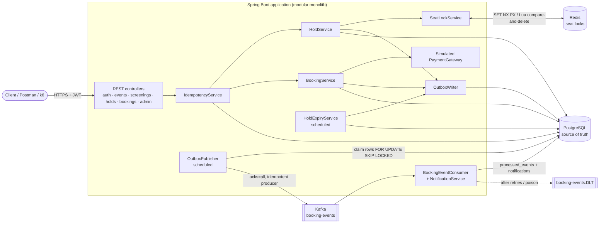
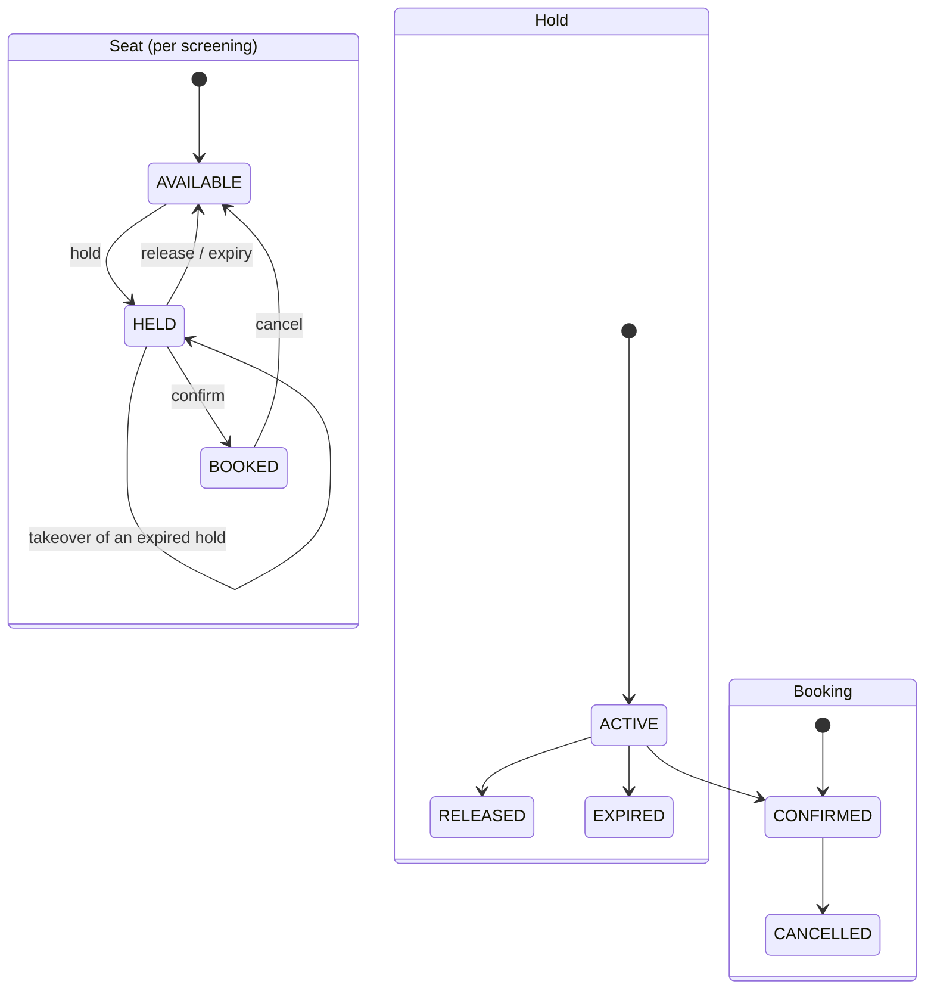
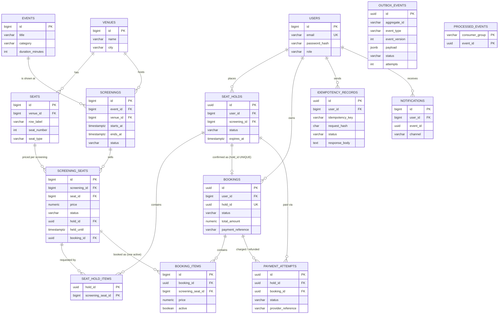

# Architecture

## Component view



## Hold → confirm sequence

```mermaid
sequenceDiagram
    autonumber
    participant C as Customer
    participant A as API
    participant I as Idempotency
    participant R as Redis
    participant P as PostgreSQL
    participant O as OutboxPublisher
    participant K as Kafka

    C->>A: POST /screenings/{id}/holds (Idempotency-Key)
    A->>I: claim key (INSERT ... ON CONFLICT DO NOTHING)
    A->>P: validate screening + seats (reads)
    A->>R: SET seat-lock:{scr}:{seat} holdId NX PX 5m (ascending order)
    A->>P: BEGIN; SELECT seats ORDER BY id FOR UPDATE
    A->>P: INSERT seat_holds; UPDATE screening_seats SET HELD WHERE AVAILABLE (rowcount must = N)
    A->>P: UPDATE idempotency_records SET COMPLETED, response; COMMIT
    A-->>C: 201 holdId, expiresAt

    C->>A: POST /bookings/confirm (holdId, paymentMethodToken, Idempotency-Key)
    A->>P: BEGIN; SELECT hold FOR NO KEY UPDATE (owner check, ACTIVE, not expired)
    A->>A: simulated charge (server decides)
    A->>P: INSERT bookings + booking_items (partial unique index), payment_attempts
    A->>P: UPDATE screening_seats SET BOOKED WHERE hold_id=? AND HELD AND held_until>now
    A->>P: UPDATE seat_holds CONFIRMED; INSERT outbox_events; idempotency COMPLETED; COMMIT
    A->>R: after commit: compare-and-set locks to sold markers booked:{bookingId}
    A-->>C: 201 booking

    O->>P: claim PENDING rows (lease, SKIP LOCKED)
    O->>K: send, wait for ack
    O->>P: mark PUBLISHED
```

## State machines



## Entity-relationship diagram



### Constraints that carry the correctness guarantees

| Constraint | Guarantees |
|---|---|
| `uq_screening_seats (screening_id, seat_id)` | one inventory row per seat per screening |
| `ck_screening_seats_state` | HELD ⇔ hold_id + held_until set; BOOKED ⇔ booking_id set; AVAILABLE ⇔ nothing set |
| `ux_booking_items_active_seat` (partial unique, `WHERE active`) | **at most one active booking per screening seat** |
| `uq_bookings_hold (hold_id)` | a hold becomes at most one booking |
| `ex_screenings_no_overlap` (GiST exclusion) | a venue never has overlapping scheduled screenings |
| `uq_idempotency_user_key (user_id, idempotency_key)` | one claim per key per user |
| `processed_events PK (consumer_group, event_id)` | each event's side effects applied once per consumer group |
